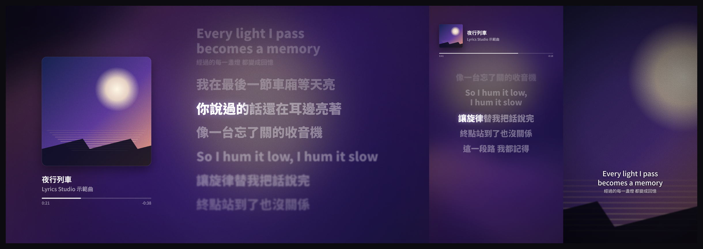

# Lyrics Studio 歌詞播放器

連接 Spotify，或直接播放 YouTube／YouTube Music 的歌，自動抓同步歌詞，用「流光」「明體」「電影」三種風格顯示，還能把畫面直接錄成影片。

A synced-lyrics player for Spotify and YouTube with three visual styles and built-in video recording. Single HTML file, no install.

**線上版 / Live：** <https://yappyap0427-png.github.io/lyrics-studio/>

## 怎麼開

**最簡單：直接打開 <https://yappyap0427-png.github.io/lyrics-studio/>**。不用安裝任何東西，建議用 Chrome 或 Edge。

**想在自己電腦上跑：**

1. 在這個頁面按綠色的 **Code → Download ZIP**，下載後解壓縮（或用 `git clone`）。`index.html`、`serve.py`、`start.bat` 要放在同一個資料夾。
2. 點兩下 `start.bat`。會出現一個黑色視窗（用的時候不要關），瀏覽器會自動打開 `http://127.0.0.1:8888/`。
   - 需要 Python。沒有的話到 <https://www.python.org/downloads/> 安裝，安裝畫面記得勾 **Add python.exe to PATH**。
   - 建議用 Chrome 或 Edge。
   - Mac：在這個資料夾開終端機，輸入 `python3 serve.py`。

不能直接點兩下 `index.html`：Spotify 登入和 YouTube 播放器都需要網址才能運作。

## 三種音樂來源（畫面左上角切換）

### 示範
內建一首示範曲，歌詞是原創的佔位文字，用來看效果、試錄影。

### YouTube（不用帳號）
點 YouTube，貼上歌曲連結就會開始播。歌在右上角的小播放器裡播放（可以拖到別的位置），歌詞跟著同步。

- YouTube Music 沒有開放讀取你在其他分頁的播放進度，所以歌是在這個程式裡播。
- 用 YouTube Music 的歌曲連結最準。MV 常有前奏或劇情，歌詞對不上時用偏移調整。
- 有些影片的版權方禁止嵌入播放，程式會提示，換一個版本就好。

### Spotify（App 擁有者要有 Premium）
Spotify 從 2026 年 2 月起規定：開發模式的 App 擁有者必須有 Premium。設定一次就好：

1. 到 <https://developer.spotify.com/dashboard> 登入，按 **Create app**，名稱和說明隨便填。
2. **Redirect URI** 填你開啟程式的網址：用線上版填 `https://yappyap0427-png.github.io/lyrics-studio/`，在自己電腦上跑填 `http://127.0.0.1:8888/`，兩個都加也可以。程式的 Spotify 設定視窗會顯示目前該填哪一個，可以直接複製。Spotify 不接受 `localhost`。
3. 勾選 **Web API**，儲存。到 Settings 複製 **Client ID**。
4. 回到程式點 Spotify，貼上 Client ID，按「連接 Spotify」並同意授權。

之後在手機、電腦等任何裝置播 Spotify，這裡都會跟著顯示。

- 程式只要求「讀取正在播放的歌」的權限，不能控制播放，所以 Spotify 模式沒有進度條。
- 登入資訊存在這個瀏覽器裡。在 Spotify 設定視窗按「中斷連線」就會刪掉。
- 同時開好幾個分頁也沒關係：只有一個分頁向 Spotify 查詢，其他分頁跟著顯示。

## 歌詞

- 會自動到 LRCLIB（免費的開放歌詞庫）找同步歌詞。找過的歌會記在這台電腦，下次不用再查。
- 找不到或抓錯：按 `L` 手動搜尋，點一份先看前幾行，對了再按「套用這份歌詞」。程式會記住你為這首歌選的歌詞。
- 不想顯示歌詞：在搜尋視窗按「這首不顯示歌詞」。按「改回自動配對」可以恢復。
- 也可以把 `.lrc` 檔拖進視窗。UTF-8、GBK、Big5 編碼都可以；沒有時間標記的文字檔會當成未同步歌詞慢慢捲動。
- 歌詞太早或太晚：按 `[` 或 `]`，每次 0.1 秒，按住 Shift 一次 0.5 秒。也可以用下方的 − 和 +。
- 同一個時間標記有兩行時，會當成「原文＋翻譯」一起顯示。

## 錄影

按 `R` 或右下角的「錄影」。開始前會倒數 3 秒（按 `Esc` 取消），錄影中可以按 `P` 或上方的「暫停」。

- 錄下來的是歌詞畫面本身，按鈕和視窗不會入鏡。
- 聲音可選：不錄、電腦正在播的聲音、麥克風（邊唱邊錄）、電腦聲音加麥克風。
- 錄電腦聲音時會跳出 Chrome 的分享視窗：
  - 用 Spotify：選「整個螢幕」，並打開「分享系統音訊」。
  - 用 YouTube 或示範：選「這個分頁」，並打開「分享分頁音訊」。
- 要發 TikTok、Reels、Shorts：先按 `V` 切到 9:16（1080×1920）。
- 切到其他分頁也會繼續錄，不過留在這個分頁畫面最順。
- 檔案會自動下載，通常是 `.mp4`。如果是 `.webm`，用剪輯軟體或轉檔工具轉成 mp4 再上傳。
- 如果這台電腦錄出來的 MP4 是空的，程式會提示並自動改用 WebM。
- 錄影檔在存檔前放在記憶體裡，上限約 1.5 GB，快到時會提醒，到了會自動停止並存檔。MP4 的上限用畫質估算（高畫質約 13 分鐘、標準約 26 分鐘）；要錄更久，在錄影視窗把格式改成 WebM。

## 快捷鍵

| 按鍵 | 作用 |
| --- | --- |
| 空白鍵 | 播放或暫停（YouTube、示範） |
| ← → | 倒退或快轉 5 秒（YouTube、示範） |
| `[` `]` | 歌詞提早或延後 0.1 秒，按住 Shift 一次 0.5 秒 |
| `L` | 搜尋歌詞 |
| `T` | 切換風格：流光、明體、電影 |
| `V` | 切換比例：填滿、16:9、9:16、1:1 |
| `R` | 開始或停止錄影 |
| `P` | 錄影中暫停或繼續 |
| `Esc` | 取消錄影前的倒數 |
| `F` | 全螢幕 |
| `H` | 隱藏或顯示介面 |

滑鼠（YouTube、示範）：點一行歌詞跳到那裡，在空白處點兩下播放或暫停，下方的進度條可以拖曳，YouTube 另有音量。點下方的風格和比例按鈕會打開選單，滑過風格就能預覽。

## 遇到問題

- **直接點兩下 `index.html` 開啟**：Spotify 和 YouTube 不能用，畫面上方會提示。請用線上版，或在資料夾裡點兩下 `start.bat`。
- **Spotify 顯示 `INVALID_CLIENT: Invalid redirect URI`**：開發者後台的 Redirect URI 要和程式顯示的一模一樣，包括最後的 `/`。
- **Spotify 拒絕存取（403）**：App 擁有者的帳號需要 Premium。用別的 Spotify 帳號登入的話，要先在 App 的 User Management 加入那個帳號（最多 5 個）。
- **黑色視窗說 port 被佔用**：用記事本打開 `start.bat`，把 `PORT=8888` 改成別的數字（例如 8890），Spotify 的 Redirect URI 也要改成同一個數字。
- **畫面不順**：在設定裡關掉「遠處的歌詞模糊」，錄影改用 30 fps。
- **字型**：第一次開啟會從 Google Fonts 下載字型，沒有網路時會改用電腦內建的字型。

## 版權

歌曲和歌詞都有版權。自己看、自己練唱沒問題；錄下來公開發布，可能會被平台以版權為由下架或靜音。Spotify 的開發模式只限個人、非商業用途。

## 專案結構

| 路徑 | 內容 |
| --- | --- |
| `index.html` | 整個程式（由 `build.py` 產生，直接用這個） |
| `serve.py`、`start.bat` | 在 `http://127.0.0.1:8888` 開本機伺服器並打開瀏覽器 |
| `src/` | 原始碼：`lrc.js` 解析歌詞、`lyrics.js` 查 LRCLIB、`sources.js` Spotify／YouTube／示範、`renderer.js` 畫面、`recorder.js` 錄影、`app.js` 介面 |
| `build.py` | 把 `src/` 合併成 `index.html` |
| `test/` | `lrc.test.js` 歌詞解析、`unit.test.js` 其他純函數的測試；`run.py` 用 Playwright 在瀏覽器跑完整流程（Spotify、YouTube、歌詞庫都用模擬回應） |

## 修改程式

1. 改 `src/` 裡的檔案。
2. 執行 `python3 build.py`，重新產生 `index.html`。
3. 測試：`node test/lrc.test.js` 和 `node test/unit.test.js`；完整測試 `python3 test/run.py`（需要安裝 Playwright、Chrome 和 ffmpeg）。
